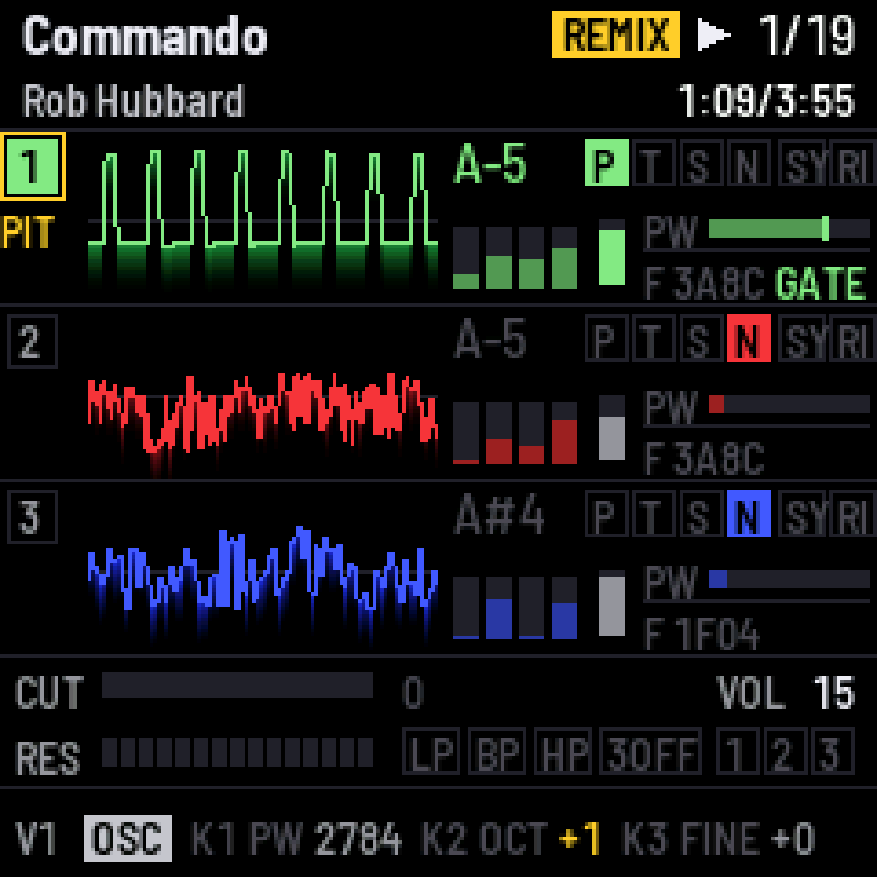

# SiDJ

*A C64 music deck for the M-VAVE FM-1.*

<p align="center"></p>

SiDJ is free firmware that turns the FM-1 into a player and live remixer for Commodore 64 music.
It plays the tunes of the [High Voltage SID Collection](https://hvsc.c64.org) on a cycle-exact
emulated C64, and every voice is yours to remix from the panel or a MIDI keyboard: transpose,
mute and solo, swap waveforms, bend envelopes and the filter, add LFOs, ride the tempo and a
vinyl fader. The remix builds on the one I made for the TherapSID.

The sound comes out three ways, alone or together:

- **The FM-1's audio jack**, from an emulated 6581 or 8580 SID chip.
- **USB audio**: the FM-1 is a driverless audio interface for your computer, with the mix or
  each voice on its own channel, ready to record.
- **Real SID hardware** over ASID: a SidStation, TherapSID, TeensyROM, USBSID-Pico or any other
  ASID receiver, with the remix included.

▶ **[Watch SiDJ in action](https://youtu.be/bY161B9_Evk)**, a demo video on YouTube.

## Get started

1. Open <https://thomasj.github.io/fm1-sidj/> in Chrome or Edge, connect the FM-1 by USB and
   press **Install**.
2. On the same page, add songs: two of mine in one click, or search your copy of HVSC.
3. Play. The [browser emulator](https://thomasj.github.io/fm1-sidj/emu/) runs the same
   firmware if you want to try it first.

Installing custom firmware is at your own risk. The same page puts M-VAVE's official firmware
back whenever you like.

# User manual

SiDJ has two screens: **SONGS**, the list of tunes on the FM-1, and the **PLAYER**. `SEQ`
switches between them. At power-on a short intro plays; any button skips it.

Below, `A` & `B` means: hold `A`, then press `B`. A *voice button* is `HOME`, `SAVE` or `ARP`,
for voice 1, 2 or 3.

## Songs

| Control | Function |
| --- | --- |
| `SELECT` | move through the list |
| `OCT-` | eight songs up the list |
| `OCT+` | eight songs down the list |
| `PLAY` | play the song and go to the player |
| `PRESETS` | the subsong |
| `KNOB 1` | the chip: AUTO (the one the tune was written for), 6581 or 8580 |
| `KNOB 2` | the output: the emulated SID, ASID, or both |
| `KNOB 3` | USB audio: the mix, or the mix and the three voices |
| `SAVE` | keep these settings, and this song as the one selected at power-on |

The list is grouped by composer, with each song's length from HVSC. The FM-1 holds a few
dozen tunes at a time (240 KB). Add and remove them from the
[web page](https://thomasj.github.io/fm1-sidj/#songs), or with `tools/fm1_sid.py` (below).

SiDJ plays PSID and RSID tunes for one SID, multi-speed tunes up to at least 38x included.
Tunes for two or three SIDs, and BASIC tunes, are not played.

## Player

The screen shows the song, its time and length, and the three voices, each with a scope, its
note, waveform, envelope and pulse width; the filter is beneath them.

| Control | Function |
| --- | --- |
| `PLAY` | play / pause |
| `REC` & `PLAY` | play from the start |
| `SELECT` | the next / previous song |
| `PRESETS` | the subsong |
| `ALGORITHM` | the output: the emulated SID, ASID, or both |
| `MASTER` | the level at the audio jack |
| `SEQ` | back to the song list |

A song or subsong picked with `SELECT` or `PRESETS` stops the one playing and waits for `PLAY`.
A song stops at its end and waits: `SELECT` for the next, `PLAY` to hear it again.

## Remix

The remix changes what reaches the chip, never the tune itself. Whatever you change turns
**gold** on screen, with REMIX in the top bar. `OCT-` and `OCT+` pressed together put
everything back. Loading a song starts clean.

**Voices and keys**

| Control | Function |
| --- | --- |
| `HOME` | select voice 1 |
| `SAVE` | select voice 2 |
| `ARP` | select voice 3 |
| The keys | play the selected voice: in *set* mode (the default) it holds the key's note while the key is down; in *transpose* mode the tune's melody moves by the key's distance from F#4 |
| `OCT-` | the keys an octave down, three at most; the screen shows their range |
| `OCT+` | the keys an octave up, three at most |
| `FX` & `OCT-` | the keys transpose |
| `FX` & `OCT+` | the keys set the pitch |
| A MIDI keyboard | plays like the keys, over USB or the MIDI IN jack: channels 1 to 3 play voices 1 to 3, any other channel the selected voice |
| `REC` | mute / unmute the selected voice |
| voice button & `REC` | solo that voice; again for all three |

**Waveforms** (the same button again gives the tune's waveform back)

| Control | Function |
| --- | --- |
| voice button & `FX` | pulse |
| voice button & `SEL` | triangle |
| voice button & `ENV` | sawtooth |
| voice button & `LFO` | noise |
| voice button & `EDIT` | sync on / off |
| voice button & `GLO` | ring modulation on / off |

Drums keep sounding like drums: a voice playing pure noise keeps its waveform and its pitch.

**Filter**

| Control | Function |
| --- | --- |
| `SEL` & `HOME` | voice 1 through the filter or around it |
| `SEL` & `SAVE` | voice 2 through the filter or around it |
| `SEL` & `ARP` | voice 3 through the filter or around it |
| `SEL` & `LFO` | low-pass on / off |
| `SEL` & `EDIT` | band-pass on / off |
| `SEL` & `GLO` | high-pass on / off |
| `SEL` & `OCT+` | the cutoff knob scales the tune's cutoff (the default) |
| `SEL` & `OCT-` | the cutoff knob adds to the tune's cutoff |

**Knob pages** (press the page button, then turn `KNOB 1` to `KNOB 4`)

| Page | KNOB 1 | KNOB 2 | KNOB 3 | KNOB 4 |
| --- | --- | --- | --- | --- |
| `FX` (OSC) | pulse width | octave | fine tune | |
| `ENV` | attack | decay | sustain | release |
| `SEL` (FLT) | cutoff | resonance | | |
| `LFO` | rate | depth | target: pulse width, pitch or cutoff | shape |
| `GLO` | tempo, 25 to 150 % | vinyl fader, ±8 % | | |

Each voice has its own LFO. The tempo speeds the tune up without changing its pitch; the vinyl
fader moves both, like a turntable. A new song or subsong starts at 100 % with the fader at 0,
as the rest of the remix starts clean. RSID tunes, which drive the whole C64 themselves, play
as written: no tempo, fader or LFOs.

**MIDI.** A MIDI controller can play the whole remix too, with a CC for every control above.
The map is in the addendum [SiDJ over MIDI](docs/midi.md).

## Outputs

**The audio jack** plays the emulated SID; `MASTER` sets its level.

**USB audio.** Connected to a computer, the FM-1 shows up as an audio input, *SiDJ FM-1*:
44.1 kHz, no driver needed on macOS, Windows, Linux or iOS. `KNOB 3` in SONGS picks what it
carries:

- **USB:MIX** (the default): the mix, in stereo.
- **USB:5CH**: the mix plus each voice on its own channel (3 to 5). The voices are stems, with
  the filter and volume in them, and add up to the mix. The tempo stops at 100 % in this mode.

USB audio comes at the chip's own level, whatever `MASTER` is set to.

**ASID** sends the tune to real SID hardware: a SidStation, TherapSID, TeensyROM, USBSID-Pico or
any other [ASID](https://github.com/thomasj/asid-protocol) receiver. The remix plays on the real
chip too, and with BOTH the FM-1 plays along. The FM-1 is a USB device, so the receiver
connects through a USB-MIDI host box or a computer. ASID sends one update per frame, so sampled
sounds (drums, speech) only sound right on the emulation, and RSID tunes are never sent: they
play on the emulated SID.

# Installing

The web page, <https://thomasj.github.io/fm1-sidj/>, installs SiDJ and puts the official
firmware back (with the `FM-1.fwsc` you download from M-VAVE). From the command line:

```
.venv/bin/python3 tools/fm1_install.py --info            # what the FM-1 runs
.venv/bin/python3 tools/fm1_install.py build/sidj.fwsc   # install a package
```

Both work from M-VAVE's firmware, Felucca, X0X and SiDJ itself. If something goes wrong:
two failed starts give a safe mode (PLAY tries again), four give the chip's own update mode,
and holding `OCT-` and `OCT+` together for 5 seconds gets there too. From the chip's update mode,
`tools/fm1_rescue.sh` puts the official firmware back, and Leo Kuroshita's
[FM-1 Transporter](https://github.com/kurogedelic/FM-1-transporter) is the last resort.

**Other firmwares' data.** SiDJ keeps its songs in the flash area where Felucca and the
firmwares built on it keep their user samples (0xA0000 to 0xDBFFF). Adding songs erases what
another firmware saved there, and other firmwares cannot read SiDJ's songs. SiDJ ignores
anything in the area that is not a SiDJ song. Back up your samples and projects before you
install SiDJ.

## Songs from the command line

`tools/fm1_sid.py` manages the songs over USB, with song lengths from your HVSC copy
(`~/Music/C64Music`, or `--hvsc DIR`):

```
.venv/bin/python3 tools/fm1_sid.py list
.venv/bin/python3 tools/fm1_sid.py put ~/Music/C64Music/MUSICIANS/H/Hubbard_Rob/Commando.sid
.venv/bin/python3 tools/fm1_sid.py put ~/Music/C64Music/MUSICIANS/G/Galway_Martin/    # a whole folder
.venv/bin/python3 tools/fm1_sid.py play 3 2                                            # song 3, subsong 2
.venv/bin/python3 tools/fm1_sid.py delete 3
.venv/bin/python3 tools/fm1_sid.py compact      # reclaim the space deleted songs leave
.venv/bin/python3 tools/fm1_sid.py stats 10     # the audio load, once a second
```

# For developers

## Building

Everything builds on a Mac. The host side (tests, simulator, players) needs only Xcode's
command-line tools (`xcode-select --install`) and Python 3. Optional, from
[Homebrew](https://brew.sh): `brew install emscripten node` to build and test the browser
emulator and the web page, and `brew install gh` for releases. Docker Desktop can come from
there too (`brew install --cask docker`). The firmware needs:

- Docker Desktop, running (the JieLi toolchain is Linux x86-64 only)
- the toolchain: `tools/get_toolchain.sh` installs it to `~/.jieli/toolchain`
- the JieLi AC79 SDK (Apache-2.0; three of its files go into every package):
  `git clone --depth 1 --branch AC79NN_SDK_V1.2.1_2023-12-13 https://gitee.com/Jieli-Tech/fw-AC79_AIoT_SDK.git ~/fw-AC79_AIoT_SDK`
- Python packages: `python3 -m venv .venv && .venv/bin/pip install -r requirements.txt`
  (Pillow 11 to 13 tested; its raqm, for the screen's tabular digits, needs
  `brew install fribidi`, without which the build warns and draws proportional digits)

```
./build.sh                  # build/sidj.fwsc, a development build
./build.sh --release 1.0.0  # build/sidj-1.0.0.fwsc, a release
tests/run_tests.sh          # all tests: SID, 6510, the C64, the remix, storage, the app in the simulator
make test                   # the SID engine against the original reSID 0.16, sample by sample
make sidplay                # build/host/sidplay FILE.sid: a tune through the same C64 and SID, to WAV
web/emu/build.sh            # the browser emulator (needs Emscripten)
```

`JIELI_TOOLCHAIN` and `AC79_SDK` override the default locations; `SIDJ_TRS=0` turns the MIDI IN
jack off, `SIDJ_CDC=1` adds a USB serial console.

`tools/make_site.py build/sidj-1.0.0.fwsc` builds the web site around a package, in
`build/site`. `tools/release.sh X.Y.Z` makes a public release: the package, the tests, one
commit on the public repository, the GitHub release and the site.

## How it works

The design and its reasoning are in [docs/design.md](docs/design.md). In short:

- **The C64** (`firmware/src/c64/`) runs the tune cycle by cycle: a 6510 with IRQ and NMI, both
  CIAs, the VIC's raster and bad lines, and a small KERNAL replacement. Every SID write is
  logged with its cycle.
- **The SID** (`sid/`) is a fixed-point port of reSID 0.16, bit-exact with the original. On the
  FM-1 the pulse, sawtooth and combined waveforms are averaged over each sample against aliasing,
  and the 8580's floating waveform DAC plays the samples some tunes make with the test bit.
- **The engine** (`firmware/src/app/engine.c`) runs in the audio interrupt: each write goes
  through the remix and reaches the chip at its exact cycle.
- **The remix** (`firmware/src/app/remix.c`) keeps the tune's register image and the chip's, and
  derives one from the other.
- **ASID** (`firmware/src/app/asid.c`) sends each frame's changes as one message, cut exactly
  at the raster wrap.

## Verification

The C64 was checked against libsidplayfp's own C64 on random HVSC tunes: the SID register
writes match at a median of 99.99 % for PSID tunes and 99.92 % for RSID tunes. The audio load
was measured on the FM-1 with the heaviest tunes found, and SiDJ's limits keep the worst case
inside the budget: one SID, the tempo up to 150 %, and no tempo, fader or LFOs for RSID tunes.
Why reSID 0.16: [docs/engine-choice.md](docs/engine-choice.md).

## Layout

| Path | What |
| --- | --- |
| `sid/` | the SID engine |
| `firmware/src/c64/` | the 6510, the SID file format, the C64 and its driver |
| `firmware/src/app/` | the engine, the remix, the UI, the song store, ASID, settings, the boot and main loop |
| `firmware/src/`, `firmware/hal/`, `firmware/loader/` | the platform, the hardware layer and the update loader, from Felucca by way of X0X |
| `host/` | the simulator and the WAV player |
| `web/site/`, `web/emu/` | the web page (installer, song manager) and the browser emulator |
| `tests/` | the host tests and the simulator's scenarios |
| `tools/` | build, package, install, songs, site, release |
| `docs/` | MIDI control ([docs/midi.md](docs/midi.md)), the design, the FM-1 platform ([docs/platform.md](docs/platform.md)), the engine choice |
| `third_party/` | reSID 0.16 unmodified, the 6502 functional test, licence texts |

## Licence

SiDJ is free software: GPL-3.0-only for the firmware, GPL-2.0-or-later for the SID engine. It
is built on [Felucca](https://github.com/hugelton/Felucca) by Leo Kuroshita (the platform, the
update loader and the installer), by way of [X0X](https://github.com/charlesvestal/fm1-x0x) by
charlesvestal, and the SID engine is a port of reSID 0.16 by Dag Lem. File-by-file origins and
the licence reasoning are in [LICENSING.md](LICENSING.md). It contains no vendor material, no
Commodore ROMs and nothing from my employer. M-VAVE and FM-1 are trademarks of their owners;
SiDJ is independent of them.

# Author

I'm Thomas Jansson ([github.com/thomasj](https://github.com/thomasj)), and I make chiptune and
synth music as **tubesockor**:
[YouTube](https://www.youtube.com/@tubesockor),
[TikTok](https://www.tiktok.com/@tubesockor),
[Instagram](https://www.instagram.com/tubesockor),
[Facebook](https://www.facebook.com/tubesockor),
[X](https://twitter.com/tubesockor) and
[tubesockor.com](https://tubesockor.com). Bug reports and ideas are welcome as GitHub issues.

SiDJ is developed with the help of AI coding tools: I direct the work, review it and test it on
the FM-1.
